# Football Tracker (C++20) — Technical Documentation

> A CMake + vcpkg, CUDA-accelerated C++20 port of the Python *Football Tracker*.
> It decodes 4K drone footage, detects players and the ball with **YOLO11** through
> **ONNX Runtime**, tracks them with a self-written **BoT-SORT-style** multi-object
> tracker, classifies teams by jersey colour, self-calibrates the camera to measure
> **speed and distance in metres**, follows the ball, and renders live **space-control
> (Voronoi)** analytics — at **~25–31 FPS**, faster than the Python reference.

This document is the C++ companion to [`../tracking/DOCUMENTATION.md`](../tracking/DOCUMENTATION.md).
It describes the C++ project **in full** and, in every section, calls out **what differs
from the Python version** and *why*. Where an algorithm is unchanged in spirit, the maths
live in the Python document and the appendices here; this file concentrates on the
implementation and the porting decisions.

---

## Table of contents

- **Part I — Overview**
  - [1. Purpose and scope](#1-purpose-and-scope)
  - [2. Quick start](#2-quick-start)
  - [3. Repository layout](#3-repository-layout)
  - [4. Why a C++ port, and what was pruned](#4-why-a-c-port-and-what-was-pruned)
- **Part II — Toolchain & environment**
  - [5. Build system: CMake + vcpkg manifest mode](#5-build-system-cmake--vcpkg-manifest-mode)
  - [6. The ONNX Runtime GPU overlay port](#6-the-onnx-runtime-gpu-overlay-port)
  - [7. The custom triplet and the MSVC ABI pin](#7-the-custom-triplet-and-the-msvc-abi-pin)
  - [8. The CUDA/cuDNN runtime and model export](#8-the-cudacudnn-runtime-and-model-export)
- **Part III — Architecture**
  - [9. Threads and data flow](#9-threads-and-data-flow)
  - [10. Per-frame processing sequence](#10-per-frame-processing-sequence)
  - [11. Module map: Python → C++](#11-module-map-python--c)
  - [12. Configuration](#12-configuration)
- **Part IV — Algorithms (as re-implemented in C++)**
  - [13. Video decoding (MSMF, hardware H.264)](#13-video-decoding-msmf-hardware-h264)
  - [14. Object detection (ONNX Runtime + CUDA)](#14-object-detection-onnx-runtime--cuda)
  - [15. Camera motion estimation](#15-camera-motion-estimation)
  - [16. The self-calibrating ground model](#16-the-self-calibrating-ground-model)
  - [17. Multi-object tracking](#17-multi-object-tracking)
  - [18. Team classification](#18-team-classification)
  - [19. Kinematics: speed and distance in metres](#19-kinematics-speed-and-distance-in-metres)
  - [20. Ball tracking](#20-ball-tracking)
  - [21. Space control and possession](#21-space-control-and-possession)
  - [22. Rendering, HUD and overlays](#22-rendering-hud-and-overlays)
  - [23. Performance and system monitoring](#23-performance-and-system-monitoring)
- **Part V — Errors found and fixed**
  - [24. C++ issue log](#24-c-issue-log)
- **Part VI — Benchmarks**
  - [25. Performance journey](#25-performance-journey)
  - [26. Methodology and results](#26-methodology-and-results)
- **Part VII — Equivalence with Python**
  - [27. Output equivalence study](#27-output-equivalence-study)
- **Part VIII — Validation**
  - [28. Unit tests](#28-unit-tests)
  - [29. Known limitations (and using other clips)](#29-known-limitations)
- **Part IX — Reference**
  - [30. Command-line options](#30-command-line-options)
  - [31. Output formats](#31-output-formats)
  - [32. Keyboard shortcuts](#32-keyboard-shortcuts)
  - [33. Differences from Python — master list](#33-differences-from-python--master-list)
- **Appendices**
  - [Appendix A — Camera model mathematics](#appendix-a--camera-model-mathematics)
  - [Appendix B — Kalman filter details](#appendix-b--kalman-filter-details)
  - [Appendix C — C++20 features used](#appendix-c--c20-features-used)

---

# Part I — Overview

## 1. Purpose and scope

The program answers the same questions as the Python original, on the same footage
(`C:\media\14369070-uhd_3840_2160_30fps.mp4`, a 4K 30 fps drone shot of a football match):

- **Who is on the pitch?** Detect every player and the ball.
- **Who is who, over time?** Keep a stable identity per player (multi-object tracking).
- **Which team?** Cluster jerseys into two teams by colour.
- **How far and how fast?** Convert pixel motion into **metres**, despite a moving camera,
  via a self-calibrating ground model.
- **Where is the ball, and how fast?** Track it, recover it from a zoomed ROI when lost,
  and measure its speed/distance.
- **Who controls space?** Compute a per-team **Voronoi** space-control percentage and a
  possession estimate, and draw a tactical radar.

The deliverable is a single native executable (`tracker.exe`) plus a small static core
library (`tracker_core`). No Python runtime, no PyTorch, no `pip` — only the ONNX model
files and the CUDA/cuDNN runtime DLLs are needed at run time.

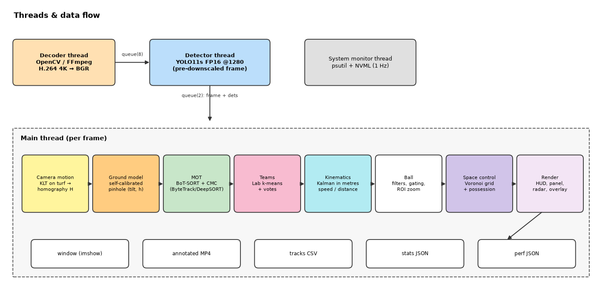
*Figure 1 — The processing pipeline. Identical in structure to Python; the boxes are now
C++ modules and the detector is ONNX Runtime instead of PyTorch.*

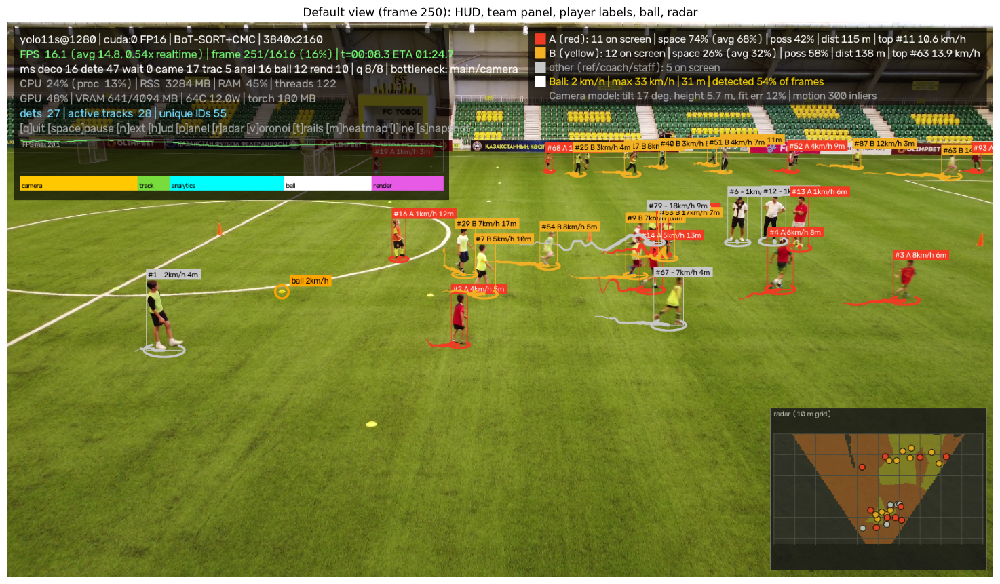
*Figure 2 — A representative annotated frame: team-coloured boxes with IDs, per-player
speed, the ball highlight, the HUD, and the tactical radar (top-right).*

## 2. Quick start

Prerequisites: **Windows**, **Visual Studio 2022** (Desktop C++ workload), **CMake ≥ 3.25**,
**vcpkg** (bootstrapped), and an **NVIDIA GPU** with a recent driver. CUDA/cuDNN runtime DLLs
are fetched by a script — you do **not** need to install the full CUDA Toolkit to *run* it.

```powershell
# 1. One-time: fetch the CUDA 12.9 / cuDNN 9 runtime DLLs into third_party/cuda-runtime
C:\pro\tracking\.venv\Scripts\python.exe tools\fetch_cuda_runtime.ps1   # or: pwsh tools\fetch_cuda_runtime.ps1

# 2. One-time: export the ONNX models (static shapes, fp16 + fp32)
C:\pro\tracking\.venv\Scripts\python.exe tools\export_static.py yolo11n yolo11s yolo11m

# 3. Configure + build (inside a VS 2022 developer environment)
#    vcpkg installs opencv4, onnxruntime-gpu-bin, cli11, nlohmann-json on first configure.
cmake --preset default
cmake --build build --config Release

# 4. Run (weights and DLLs are copied next to the exe by the build)
$env:CUDA_MODULE_LOADING = "LAZY"
build\Release\tracker.exe
```

All build steps must run inside the VS 2022 `vcvars64.bat` environment so that `cl.exe`,
the Windows SDK, and the pinned toolset are on `PATH`. The VS Code tasks in
[`.vscode/tasks.json`](.vscode/tasks.json) wrap these commands; the launch configuration in
[`.vscode/launch.json`](.vscode/launch.json) builds Release and attaches the debugger.

> **Why `CUDA_MODULE_LOADING=LAZY`?** The development laptop has an older driver (538.08,
> CUDA 12.2) than the ORT 12.8 build. Lazy module loading lets the newer runtime load only
> the kernels it actually uses, avoiding a hard failure at session creation. This is the
> same fix documented for the Python project ([issue E7 there](../tracking/DOCUMENTATION.md)).

## 3. Repository layout

```
tracking-cpp/
├─ CMakeLists.txt              # targets: tracker_core, tracker, bench_detect, tracker_tests
├─ CMakePresets.json           # Ninja Multi-Config preset, vcpkg toolchain, env vars
├─ vcpkg.json                  # manifest: deps + embedded overlay-ports/triplets config
├─ custom-triplets/
│  └─ x64-windows.cmake        # pins MSVC v143 (VS 2022) to avoid an STL ABI mismatch
├─ vcpkg-ports/
│  └─ onnxruntime-gpu-bin/     # overlay port: repackages Microsoft's prebuilt ORT GPU zip
├─ tools/
│  ├─ export_static.py         # YOLO11 → static-shape ONNX (1280 + 640, fp16 + fp32)
│  ├─ fetch_cuda_runtime.ps1   # pull CUDA 12.9 / cuDNN 9 DLLs from NVIDIA pip wheels
│  ├─ bench_detect.cpp         # standalone detector micro-benchmark
│  ├─ compare_stats.py         # side-by-side Python vs C++ stats comparison
│  └─ make_cut_test.py         # builds output/cut_test.mp4 (2 cuts + close-up) for §15.1
├─ src/                        # all C++20 sources (see the module map, §11)
├─ tests/                      # GoogleTest unit tests (18 tests)
├─ models/                     # exported .onnx files (not committed)
├─ third_party/cuda-runtime/   # fetched CUDA/cuDNN DLLs (not committed)
└─ docs/images/                # figures referenced by this document
```

**Differences from Python here:** the Python repo ships a `tracker/` Python package, a
`weights/` folder of `.pt` files, a `.venv`, and `pyproject.toml`. The C++ repo replaces
all of that with a CMake/vcpkg build graph, an ONNX `models/` folder, and a fetched CUDA
runtime. The `tools/` scripts that remain are Python only because they drive **Ultralytics'
exporter** (a build-time convenience); nothing Python is needed at run time.

## 4. Why a C++ port, and what was pruned

The port keeps every *useful* capability of the Python proof of concept and deliberately
**prunes the options that proved dead or slow**, as the brief requested. The guiding rule
was: *understand each feature and re-implement it as an idiomatic C++20 engineer — not a
line-by-line transliteration — and cut dead wood.*

| Capability | Python | C++ | Rationale |
|---|---|---|---|
| Detector | YOLOv5 **and** YOLOv8/11 via PyTorch Hub | **YOLO11 only**, via ONNX Runtime | YOLOv5 + `torch.hub` was the slowest, least accurate path; YOLO11 dominated it on every axis. |
| Tracker | DeepSORT, ByteTrack, BoT-SORT selectable | **one** BoT-SORT-style tracker | DeepSORT's appearance ReID never improved identity on this footage and cost ~2× time. ByteTrack was a strict subset of what BoT-SORT already does. |
| Re-identification | optional ReID embedder | **removed** | Appearance embeddings added latency with no measurable identity gain on long-shot drone footage. |
| Inference runtime | PyTorch (CUDA) | **ONNX Runtime (CUDA EP)** | No Python/torch dependency; smaller, faster, deployable as a plain exe. |
| Numerics | NumPy / SciPy | **OpenCV `cv::Matx` + hand-written solvers** | Keeps the project dependency-light and the maths explicit and documented. |

Options **kept** (because they were useful): fp16 inference, the ball ROI zoom-recovery,
team classification, the self-calibrating ground model, the Voronoi space control, the
radar, the counting line, trails/heatmap, perf + NVML monitoring, CSV/JSON exports.

Options **removed** from the CLI (dead or redundant): `--tracker`, `--reid`, `--n-init`,
`--nn-budget`, `--embedder`, and the `yolov5*`/`yolov8*` model names.

Options **added** in C++: `--models-dir`, `--cuda-dir`, and `-v/--verbose`.

The full before/after option list is in [§33](#33-differences-from-python--master-list).

---

# Part II — Toolchain & environment

This is the part of the project with the **most new material** relative to Python: the
Python version just needed `pip install`, whereas a reproducible native CUDA build needs a
carefully pinned toolchain. Each of the four pieces below was a genuine obstacle; the issue
log in [§24](#24-c-issue-log) records how each was diagnosed.

## 5. Build system: CMake + vcpkg manifest mode

The build is driven by **CMake** with a **Ninja Multi-Config** generator and **vcpkg in
manifest mode**, so dependencies are declared in [`vcpkg.json`](vcpkg.json) and installed
automatically on first configure — no global package state.

```jsonc
// vcpkg.json (abridged)
{
  "dependencies": [
    { "name": "opencv4",
      "default-features": false,
      "features": ["calib3d", "highgui", "intrinsics", "jpeg", "msmf",
                   "png", "thread", "win32ui"] },
    "onnxruntime-gpu-bin",     // our overlay port (see §6)
    "cli11",
    "nlohmann-json"
  ],
  "features": { "tests": { "dependencies": ["gtest"] } },
  "builtin-baseline": "23b8a8e7409c2d6346114a88e834165bde79a51c",
  "vcpkg-configuration": {
    "overlay-ports":    ["C:/pro/tracking-cpp/vcpkg-ports"],
    "overlay-triplets": ["C:/pro/tracking-cpp/custom-triplets"]
  }
}
```

Two hard-won details:

- **OpenCV is stripped to what we use.** `default-features: false` plus an explicit feature
  list avoids pulling in `dnn`, `ffmpeg`, Qt, etc. We deliberately **do not** use OpenCV's
  `dnn` module (ORT is the detector) and **do not** use `ffmpeg` (MSMF provides hardware
  H.264 decode). This cut both build time and binary size.
- **Overlay paths must be absolute.** vcpkg silently ignored relative overlay paths in a
  separate `vcpkg-configuration.json` and ignored them when set via preset environment
  variables. Embedding **absolute** paths in `vcpkg.json` under `vcpkg-configuration` is the
  only form that is honoured (issue [E1](#24-c-issue-log)).

`CMakeLists.txt` defines four targets:

| Target | Kind | Purpose |
|---|---|---|
| `tracker_core` | static lib | all algorithms (detector, tracker, analytics, …) |
| `tracker` | executable | the CLI application (`main.cpp`) |
| `bench_detect` | executable | detector micro-benchmark (`tools/bench_detect.cpp`) |
| `tracker_tests` | executable | GoogleTest suite (built only with the `tests` feature) |

A post-build step copies the ONNX Runtime DLLs next to the executables so they run from the
build tree without extra `PATH` setup.

## 6. The ONNX Runtime GPU overlay port

vcpkg's registry `onnxruntime-gpu` port **builds ORT from source**, which requires a full
local CUDA Toolkit and tens of minutes. To avoid that, the project ships an **overlay port**,
[`vcpkg-ports/onnxruntime-gpu-bin`](vcpkg-ports/onnxruntime-gpu-bin), that downloads and
repackages **Microsoft's official prebuilt ORT 1.31.0 GPU (CUDA 12) zip**:

- `portfile.cmake` fetches the release zip (verified by SHA512), lays out the headers under
  `include/`, the import libs under `lib/`, and the runtime DLLs under `bin/`, and installs a
  CMake config so `find_package(onnxruntime-gpu-bin)` yields an imported target.
- `onnxruntime-gpu-bin-config.cmake` exposes the include dir, the import library, and the
  DLLs for the post-build copy.

**Why this matters / differs from Python:** PyTorch shipped CUDA inside its wheels, so Python
"just worked" after `pip install torch`. In C++ there is no such bundle; we assemble the
exact ORT + CUDA + cuDNN set ourselves. ORT 1.31 requires **CUDA ≥ 12.8**, and the CUDA
libraries that ship inside torch (12.6) are too old — hence the separate runtime fetch in §8.

## 7. The custom triplet and the MSVC ABI pin

The machine has **both** Visual Studio 2022 (toolset v143, MSVC 14.44) **and** Visual Studio
2026 (toolset v18, MSVC 14.50). vcpkg auto-selected the newest (2026), so vcpkg-built
libraries used the 14.50 STL while the app was compiled with 14.44. That mismatched the
internal STL ABI and produced a link error (`__std_find_first_not_of_trivial_pos_1`,
unresolved in CLI11 — issue [E3](#24-c-issue-log)).

The fix is a **custom triplet**, [`custom-triplets/x64-windows.cmake`](custom-triplets/x64-windows.cmake),
that pins the toolchain for every vcpkg package:

```cmake
set(VCPKG_TARGET_ARCHITECTURE x64)
set(VCPKG_CRT_LINKAGE dynamic)
set(VCPKG_LIBRARY_LINKAGE dynamic)
set(VCPKG_PLATFORM_TOOLSET v143)                  # force VS 2022, not VS 2026
# Native backslashes: newer vcpkg versions compare this path literally (issue E17).
set(VCPKG_VISUAL_STUDIO_PATH
    "C:\\Program Files\\Microsoft Visual Studio\\2022\\Professional")
```

Because the application and all dependencies now build with the same toolset, the STL ABI is
consistent. (There is no analogue of this problem in Python — it only arises because native
libraries share one C++ ABI.)

## 8. The CUDA/cuDNN runtime and model export

**Runtime DLLs.** [`tools/fetch_cuda_runtime.ps1`](tools/fetch_cuda_runtime.ps1) pulls
**CUDA 12.9** and **cuDNN 9.27** runtime DLLs out of NVIDIA's pip wheels (no Toolkit install)
into `third_party/cuda-runtime/bin`. At startup, [`runtime_env.cpp`](src/runtime_env.cpp)
prepends that folder to the process `PATH` (and `--cuda-dir` overrides it), so ORT's CUDA
execution provider finds `cudart64`, `cublas`, `cudnn`, etc.

**Model export.** [`tools/export_static.py`](tools/export_static.py) uses Ultralytics to
export each YOLO11 variant to **static-shape** ONNX, producing both the main inference size
and the ball-ROI size, in fp32 and fp16:

```
models/yolo11s.onnx         # 1280 long side, fp32
models/yolo11s_fp16.onnx    # 1280, fp16 (default on CUDA)
models/yolo11s_640.onnx     # 640 long side (ball ROI zoom), fp32
models/yolo11s_640_fp16.onnx# 640, fp16
```

Static shapes are the single biggest detector speed-up (see [§25](#25-performance-journey)):
ORT/cuDNN can select and cache the optimal convolution algorithms when the input dimensions
are fixed. The earlier `tools/export_models.py` produced dynamic-shape models and is
superseded.

---

# Part III — Architecture

## 9. Threads and data flow

The design mirrors the Python pipeline but uses native threads and a bounded queue:

```
 ┌────────────┐   frames    ┌──────────────┐   results   ┌────────────────┐
 │  Decoder   │ ─────────▶  │   Detector   │ ─────────▶  │  Main thread   │
 │ (jthread)  │  BoundedQ   │  (jthread)   │   BoundedQ  │ track→analytics│
 │  MSMF HW   │             │  ORT + CUDA  │             │  →render→show  │
 └────────────┘             └──────────────┘             └────────────────┘
```

- **Decoder thread** ([`video_reader.cpp`](src/video_reader.cpp)): an `std::jthread` that
  reads frames via OpenCV's MSMF backend with hardware acceleration and pushes them into a
  [`BoundedQueue`](src/bounded_queue.hpp) (default depth 8, `--queue-size`).
- **Detector thread** ([`app.cpp`](src/app.cpp)): pulls frames, runs YOLO11 through ORT, and
  pushes `(frame, detections)` into a second bounded queue. Decoupling detection from the
  main loop hides inference latency behind decode and render.
- **Main thread**: tracking, camera/ground update, team classification, kinematics, ball,
  space control, rendering, and display/recording.

The `BoundedQueue<T>` is a small condition-variable queue with blocking `push`/`pop` and a
`close()` for clean shutdown — the C++ equivalent of Python's `queue.Queue(maxsize=…)`.
Its unit test was rewritten to be deterministic after an initial race (issue [E9](#24-c-issue-log)).

**Difference from Python:** Python used the GIL-bound `threading` module, so its decoder and
detector threads mostly overlapped I/O and CUDA waits. C++ threads run truly in parallel,
which is partly why the C++ main thread is leaner (see [§25](#25-performance-journey)).

## 10. Per-frame processing sequence

For each frame the main thread performs the same ordered stages as Python:

1. **Camera stage** — estimate frame-to-frame camera motion (homography) via sparse KLT on
   the turf, then update the self-calibrating ground model.
2. **Track stage** — associate detections to tracks (BoT-SORT-style), producing stable IDs.
3. **Analytics stage** — per track: team colour, foot point, metric kinematics; update trails
   and heatmap; counting-line crossings.
4. **Ball stage** — pick the best ball detection; if lost, zoom a static-640 ONNX session on a
   predicted ROI; Kalman-filter the ball; compute its speed/distance.
5. **Render stage** — draw boxes, IDs, speeds, ball, HUD, radar, and (optionally) the Voronoi
   overlay; show and/or record.

## 11. Module map: Python → C++

Every Python module has a direct C++ counterpart; the table is the Rosetta stone for the port.

| Concern | Python (`tracker/…`) | C++ (`src/…`) | Notes |
|---|---|---|---|
| Entry point | `__main__.py` | [`main.cpp`](src/main.cpp) | parses config, runs `App` |
| App orchestration | `app.py`, `pipeline.py` | [`app.cpp`](src/app.cpp)/`.hpp` | threads, stages, reports |
| Configuration | `config.py` | [`config.cpp`](src/config.cpp)/`.hpp` | CLI11 instead of argparse |
| Device selection | `device.py` | [`runtime_env.cpp`](src/runtime_env.cpp)/`.hpp` | CUDA DLL PATH + LAZY env |
| Video decode | `video.py` | [`video_reader.cpp`](src/video_reader.cpp)/`.hpp` | MSMF HW, `jthread` |
| Detection | `detector.py` | [`detector.cpp`](src/detector.cpp)/`.hpp` | ONNX Runtime, fp16 |
| Camera motion | `camera.py` | [`camera_motion.cpp`](src/camera_motion.cpp)/`.hpp` | KLT homography |
| Ground model | `geometry.py` | [`geometry.cpp`](src/geometry.cpp)/`.hpp` | IRLS Gauss-Newton fit |
| Tracking | `mot.py` | [`tracker.cpp`](src/tracker.cpp)/`.hpp`, [`kalman_box.hpp`](src/kalman_box.hpp) | greedy BoT-SORT + BYTE |
| Kinematics | `kinematics.py` | [`kinematics.cpp`](src/kinematics.cpp)/`.hpp` | full 4×4 Kalman |
| Teams | `team.py` | [`team.cpp`](src/team.cpp)/`.hpp` | k-means on jersey colour |
| Ball | `ball.py` | [`ball.cpp`](src/ball.cpp)/`.hpp` | ROI zoom recovery |
| Space control | `space.py` | [`space.cpp`](src/space.cpp)/`.hpp` | Voronoi grid |
| Analytics overlays | `analytics.py` | [`analytics.cpp`](src/analytics.cpp)/`.hpp` | trails, heatmap, line |
| Rendering / HUD | `overlay.py` | [`overlay.cpp`](src/overlay.cpp)/`.hpp` | HUD, radar |
| Perf / system | `perf.py` | [`perf.cpp`](src/perf.cpp)/`.hpp` | RollingStat, NVML |
| Shared types | (scattered) | [`common.hpp`](src/common.hpp), [`log.hpp`](src/log.hpp) | `Detection`, `Track`, logging |

Every module/class/method carries **Doxygen** comments (`@brief`, `@param`, `@return`), per
the brief's request for maximum, well-explained documentation.

## 12. Configuration

[`Config`](src/config.hpp) is a plain struct of fields with sane defaults; `parseArgs()` in
[`config.cpp`](src/config.cpp) wires each field to a **CLI11** option (grouped into input,
tracking, analytics, and output sections — see `--help` and [§30](#30-command-line-options)).
This replaces Python's `argparse`. CLI11 gives typed options, range validation
(e.g. `--conf` ∈ [0.01, 0.99]), and grouped help "for free".

---

# Part IV — Algorithms (as re-implemented in C++)

Each algorithm is re-stated at implementation level, with the **C++-specific choices**
highlighted. For the underlying derivations (camera geometry, Kalman equations, Voronoi),
see the appendices and the Python document.

## 13. Video decoding (MSMF, hardware H.264)

[`VideoReader`](src/video_reader.hpp) opens the file with OpenCV's **Media Foundation (MSMF)**
backend and requests hardware acceleration:

```cpp
cap.open(path, cv::CAP_MSMF, { cv::CAP_PROP_HW_ACCELERATION, cv::VIDEO_ACCELERATION_ANY });
```

On this machine that engages the GPU's H.264 decoder; the HUD reports **"MSMF (HW)"**. A
background `std::jthread` decodes ahead into the bounded queue so the detector never waits on
I/O. Seeking (`--start-frame`) uses `CAP_PROP_POS_FRAMES`.

**Difference from Python:** Python decoded through OpenCV's default (often FFmpeg) backend.
C++ uses MSMF with explicit hardware acceleration and **no FFmpeg dependency** at all, which
keeps the dependency graph small and the decode cheap.

## 14. Object detection (ONNX Runtime + CUDA)

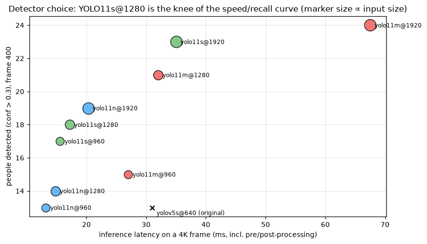
*Figure 3 — YOLO11 variants: accuracy vs. latency. `yolo11s` is the default sweet spot.*

[`Detector`](src/detector.hpp) wraps ONNX Runtime. Key design points:

- **One session per input size.** The main detector runs at 1280 (long side); the ball ROI
  recovery runs a separate **static-640** session so the two never compete for the same cuDNN
  workspace. Sessions are created lazily in `netFor(size)` under a mutex and cached in a map.
- **CUDA provider tuning.** The CUDA execution provider is configured with
  `cudnn_conv_algo_search = EXHAUSTIVE`, `cudnn_conv_use_max_workspace = 1`, and
  `arena_extend_strategy = kSameAsRequested`. Exhaustive algorithm search plus a large
  workspace shaved detect time substantially on static-shape models.
- **FP16 I/O.** The fp16 models have fp16 **inputs and outputs**. Preprocessing writes
  `float16` directly (via a small `floatToHalf`/`halfToFloat` pair in an anonymous namespace),
  and `Ort::Value::CreateTensor` is given a **byte count**, not an element count (issue
  [E7](#24-c-issue-log)). The raw output is decoded **only for the requested classes**, so we
  never convert the full ~2.8 M-value tensor (issue [E13](#24-c-issue-log)).
- **Preprocessing.** A single pass does letterbox (centred, pad value 114), BGR→RGB, scale to
  [0,1], and HWC→CHW into reused `thread_local` buffers — no per-frame allocation.
- **Post-processing.** Hand-written, class-aware **NMS** and a decode that applies the
  letterbox inverse to map boxes back to full-resolution image coordinates.
- **Warmup.** Each session size is run 3× at startup so the first real frame isn't penalised
  by lazy allocation and algorithm search.

**Difference from Python:** Python called `model(frame)` on a PyTorch module and read a
pandas DataFrame of results. C++ manages the ONNX session, tensor layout, fp16 conversion,
NMS and letterbox inverse **explicitly** — more code, but no Python/torch and markedly faster.

## 15. Camera motion estimation

[`CameraMotion`](src/camera_motion.hpp) estimates a frame-to-frame **homography** by tracking
sparse good-features on the turf with pyramidal **Lucas–Kanade (KLT)** optical flow, then
fitting a homography with RANSAC (`cv::findHomography`). Player regions are masked out so only
the (planar) pitch drives the estimate.

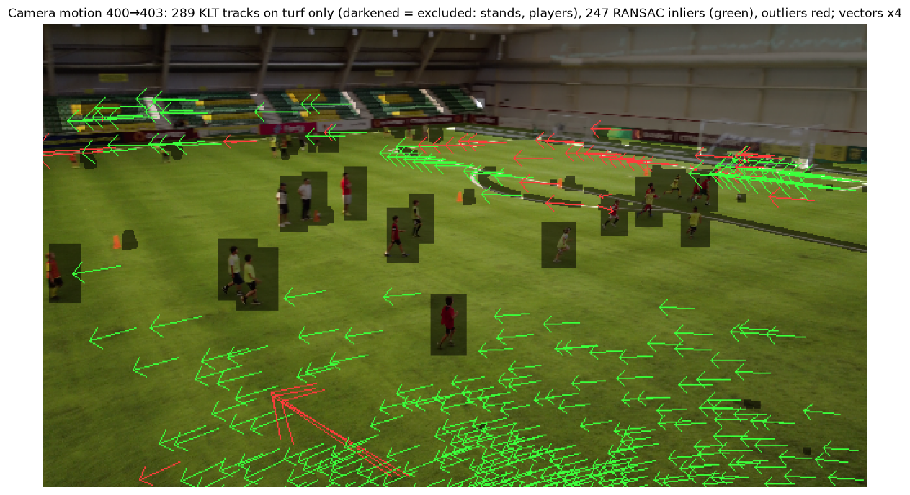
*Figure 4 — KLT feature tracks on the turf drive the inter-frame homography.*

This homography is reused three ways: to warp previous foot points into the current frame
(kinematics), to update the ground model, and to stabilise track prediction in the tracker.
The algorithm matches Python one-to-one; only the API is OpenCV-C++ instead of OpenCV-Python.

### 15.1 Shot-cut and non-pitch-view detection (C++ only)

The original footage is one continuous drone shot, but other clips (TV broadcasts, edited
highlights) contain **cuts**: the next frame comes from another camera. Without a check, the
tracker would match old boxes to unrelated players, the kinematics would integrate a "teleport",
and the ground model would blend two different camera geometries. `CameraMotion` therefore also
computes, at the 640-px processing scale:

- a **hue/saturation histogram** (30 × 32 bins, L1-normalised) compared with the previous frame
  by correlation (`cv::compareHist`, `HISTCMP_CORREL`). Camera motion keeps the colours, a cut
  changes them;
- the **turf ratio of the lower half of the frame**, the fraction of the bottom half inside the
  green grass mask. A camera filming the pitch has grass under it: the reference drone video never
  drops below **0.95** (median 0.98). A close-up of the stadium wall drops to **0.58**, even though
  its big green/yellow banner pushes the *whole-frame* turf ratio up to 0.46–0.70. Using the whole
  frame would have been fooled by the banner, which is why the lower half is used.

| Condition | Decision | What the app does |
|---|---|---|
| histogram correlation < **0.5** | **hard cut** (KLT skipped) | reset tracker, ground model, ball, ball kinematics; invalidate player kinematics |
| KLT/RANSAC failed **and** correlation < **0.85** | **soft cut** (e.g. two wide shots of the same pitch) | same as a hard cut |
| KLT/RANSAC failed, correlation ≥ 0.85 | motion blur, not a cut | kinematics invalidated for one frame (as in Python) |
| lower-half turf < **70 %** | **non-pitch view** (close-up, crowd, replay graphics) | no calibration samples, no speed/distance integration, no space control |

`BotSortTracker::reset()` keeps the id counter running, so a player seen after a cut never
inherits a pre-cut id. `GroundModel::reset()` keeps the old tilt/height only as a starting guess:
the model reports *not ready* (no metric output) until the new shot has been fitted, and that
first fit is taken as-is rather than blended with the old camera.

**Validation.**

| Clip | Expected | Measured |
|---|---|---|
| Reference drone video, all 1,616 frames | 0 cuts, 0 non-pitch | **0 cuts, 0 non-pitch** (mean lower turf 97–100 %) |
| Reference segment 400–700 | identical stats to the build without the checks | **identical** (Team A 10 ids / 99 m / 16.0 km/h, ball 23 m / 38 km/h, 29.7 FPS) |
| `cut_test.mp4` (generated by [`tools/make_cut_test.py`](tools/make_cut_test.py)), an edited clip built from the reference: 90 wide frames → 45 frames of a wall/banner close-up → 90 frames from another part of the match, lower and closer | cuts at 90 and 135; 45 non-pitch frames | **cuts at 90 (soft, corr 0.53) and 135 (hard, corr 0.49); 45 non-pitch frames**, both warnings printed |

The first cut (corr 0.53) shows why the soft-cut rule exists: the two shots share the same
colours, so only the combination "features lost + colours shifted" separates it from a pan.

## 16. The self-calibrating ground model

[`GroundModel`](src/geometry.hpp) maps image points to a **metric ground plane** without any
manual calibration. It assumes a pinhole camera of known horizontal FOV looking down at the
pitch with unknown **tilt** and **height**, and recovers those two parameters online from the
apparent heights of detected people (whose real height is ~1.4 m).

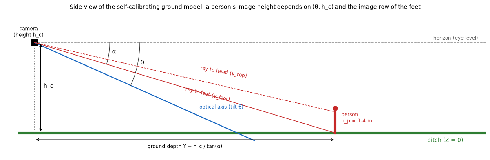
*Figure 5 — The camera geometry: tilt and height define the homography to the ground plane.*

The fit is an **iteratively reweighted Gauss–Newton** solver with a `soft_l1` robust weight
`w = 1/√(1 + (r/0.08)²)`, a **numerical Jacobian**, a sliding window of 30 observations, a
refit every 5 frames, EMA smoothing (0.35), and bounds (tilt 1–85°, height 1.5–300 m). It is
**hand-written** over `cv::Matx` — the C++ stand-in for SciPy's `least_squares`.

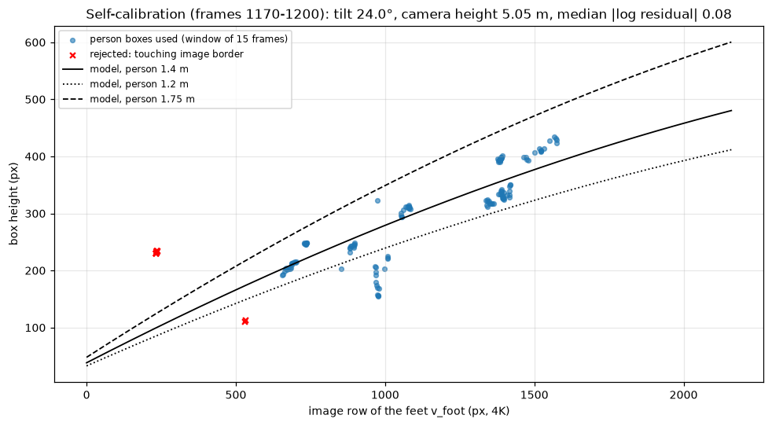
*Figure 6 — Person apparent-height samples and the robust fit that recovers camera height.*

**Difference from Python:** Python used `scipy.optimize.least_squares` with `loss='soft_l1'`.
C++ re-implements the robust IRLS loop directly (§Appendix A), which removes the SciPy
dependency and makes the numerics fully explicit. The fit output is **identical** to Python in
the equivalence study (tilt 21.6°, height 6.11 vs 6.14 m, residual 0.095 — see [§27](#27-output-equivalence-study)).

## 17. Multi-object tracking

[`Tracker`](src/tracker.hpp) is a **simplified, self-written BoT-SORT**. Per track it keeps a
[`KalmanBox`](src/kalman_box.hpp) (constant-velocity in **xyah**: centre x, centre y, aspect,
height). Association per frame:

1. **Camera compensation** — every track's predicted box is warped by the camera homography so
   a panning drone doesn't break IoU matching.
2. **BYTE two-stage split** — detections are split into high- and low-confidence sets.
3. **Confirmed-first greedy IoU matching:**
   - 3a. confirmed tracks ↔ high-confidence detections,
   - 3b. remaining confirmed tracks ↔ low-confidence detections (BYTE's "recover the weak
     detections" idea),
   - 3c. tentative (unconfirmed) tracks ↔ the leftover high-confidence detections.
4. **Update / create / age** — matched tracks are updated; **unmatched high-confidence
   detections start new tracks** (a track confirms after `nInit = 3` hits); tracks unseen for
   `--max-age` frames are dropped.

**Differences from Python / Ultralytics BoT-SORT (deliberate simplifications):**

- **Greedy IoU** instead of the **Hungarian** algorithm for assignment.
- **No appearance ReID** (the pruned DeepSORT embedder).
- **Diagonal-gain KalmanBox** (box filter) — a simplification that is adequate for association.

These simplifications make the C++ tracker **fragment a little more** than Ultralytics on
crowded frames; the effect and its downstream impact are quantified in [§27](#27-output-equivalence-study).

## 18. Team classification

[`TeamClassifier`](src/team.hpp) samples jersey pixels from each player's torso region,
reduces them to a colour feature, and runs **k-means (k = 2)** to split the field into two
teams, with a stable colour→label mapping across frames (red vs. yellow here). Goalkeepers and
the referee fall out as colour outliers.

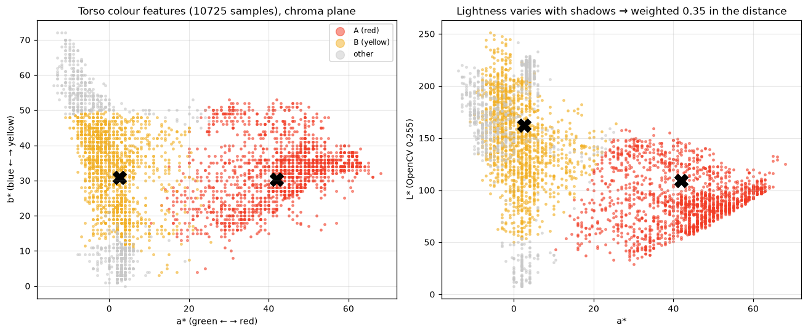
*Figure 7 — Jersey-colour clustering separates the two teams (plus outliers).*

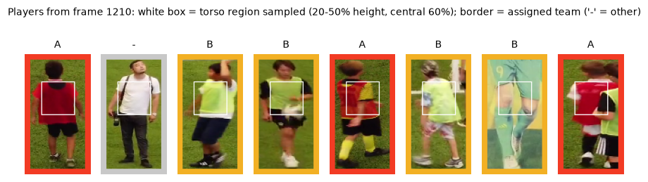
*Figure 8 — Sampled torso crops that feed the clustering.*

**Difference from Python:** same algorithm, using OpenCV's `cv::kmeans` and HSV/Lab features
in C++. The clustering is slightly more sensitive at the boundary than Python's, which is the
root cause of the Team B ID-count difference in [§27](#27-output-equivalence-study).

## 19. Kinematics: speed and distance in metres

[`Kinematics`](src/kinematics.hpp) converts each track's pixel path into **metres**, robust to
the moving camera. Per object it:

1. warps the previous foot point into the current frame with the camera homography,
2. projects both points to the ground plane and takes the metric displacement (camera motion
   cancels),
3. integrates that into a **dead-reckoned** position (its noise telescopes, it does not random-
   walk), and
4. smooths it with a **constant-velocity Kalman filter** in metres.

Gross innovations reset the filter (so an ID switch can't pump the velocity), speeds below a
dead band don't accumulate distance, and the **top speed must be sustained** over a short
window (0.5 s) so a single-frame glitch can't set a record.

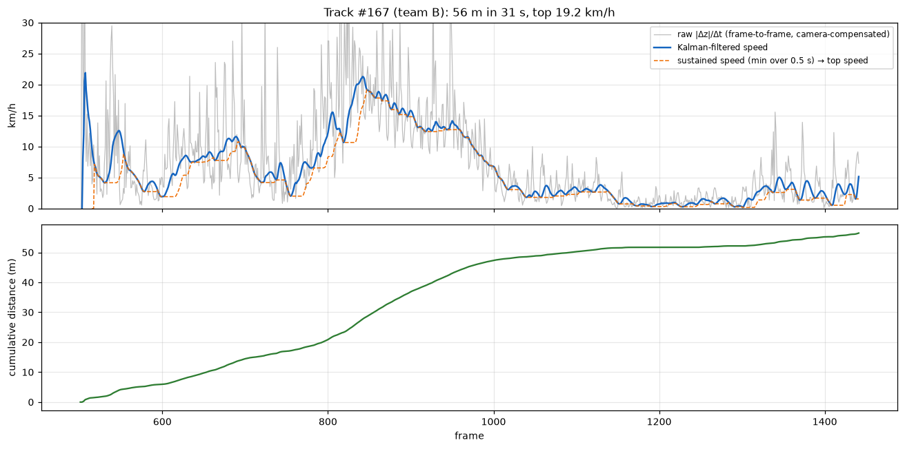
*Figure 9 — A player's metric trajectory and speed, reconstructed through the ground model.*

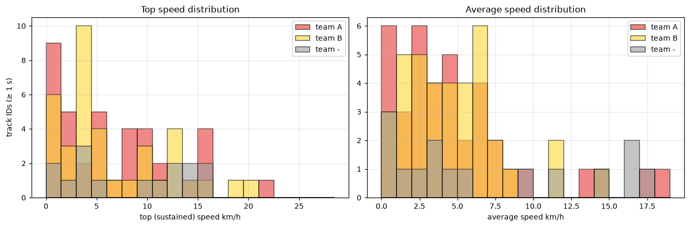
*Figure 10 — Per-team speed distributions over a run.*

**Difference from Python — and an important fix.** The first C++ port used a **diagonal-gain**
approximation of the Kalman update. That over-smoothed velocity (and let position jitter
inflate distance), so peak speeds came out **~40 % low** (e.g. Team A 9.6 vs 16.0 km/h). The
final version uses the **full 4×4 matrix Kalman** — predict `x=Fx`, `P=FPFᵀ+GGᵀq`; update with
the complete gain `K=PHᵀS⁻¹` and `P=(I−KH)P`, implemented with `cv::Matx` — **identical** to
the Python reference. After this change the kinematics match Python almost exactly (Team A top
speed 16.0 vs 16.0 km/h; ball distance/max within 2 %). See [Appendix B](#appendix-b--kalman-filter-details)
and [§27](#27-output-equivalence-study).

## 20. Ball tracking

[`BallTracker`](src/ball.hpp) selects the most plausible ball detection each frame (size, shape,
and motion gating), Kalman-filters its position, and — crucially — when the ball is lost it
**zooms a predicted ROI** and re-runs detection at high effective resolution using the separate
static-640 ONNX session.

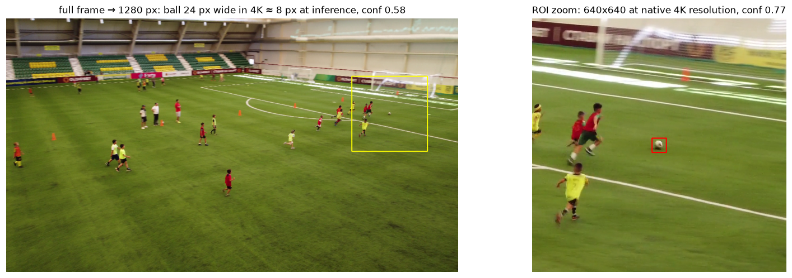
*Figure 11 — When the ball is lost, a zoomed ROI around the prediction recovers it.*

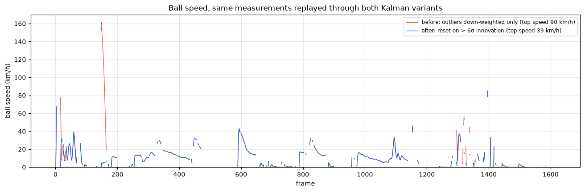
*Figure 12 — The ball Kalman filter smooths the noisy raw detections.*

Ball speed/distance reuse the same metric kinematics as players (`"ball"` key). In the
equivalence study the ball metrics track Python closely (distance 23.2 vs 23.7 m, max 38.4 vs
38.9 km/h, detection ratio 0.45 vs 0.49).

**Difference from Python:** same two-stage strategy. The ROI session is a dedicated static-640
ONNX session (Python re-used its single model at a cropped resolution), which is both the
reason for exporting `_640` models and a measurable speed win (ball stage 65 → 10 ms, [§25](#25-performance-journey)).

## 21. Space control and possession

[`SpaceControl`](src/space.hpp) rasterises the pitch into a grid and assigns each cell to the
nearest player (a discrete **Voronoi** tessellation), yielding a per-team **space-control
percentage**. Possession is estimated from proximity of the ball to each team's players over
time. A tactical **radar** condenses both into a mini-map.

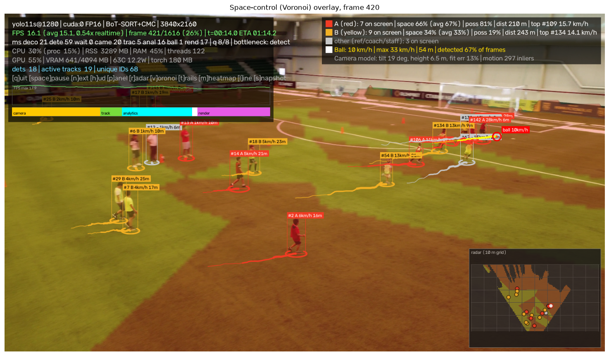
*Figure 13 — Voronoi space-control overlay (toggle with `v` or `--voronoi`).*

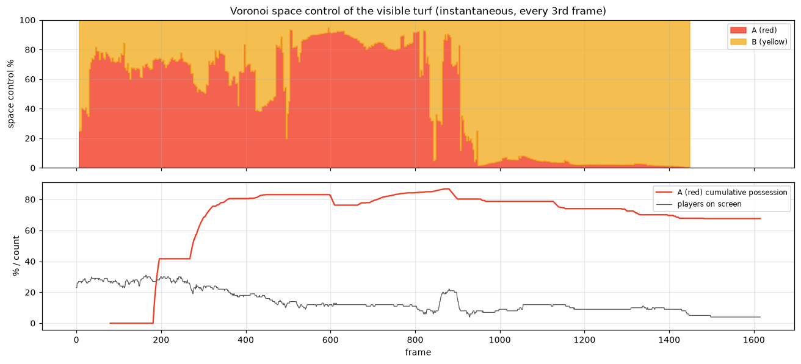
*Figure 14 — Space-control and possession evolving over a sequence.*

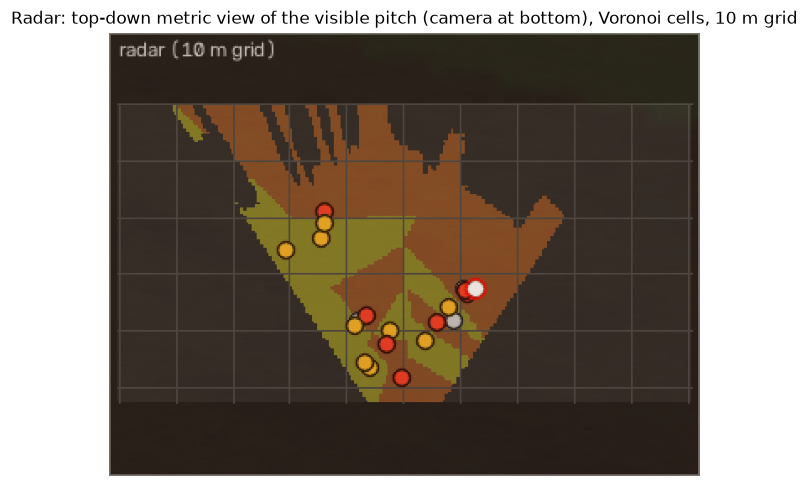
*Figure 15 — The tactical radar built from ground positions.*

**Difference from Python:** identical method. The C++ `compute()` loops grid cells × players in
plain C++; this is simpler than a vectorised NumPy version but fast enough that it is not a
bottleneck (the detector dominates).

## 22. Rendering, HUD and overlays

[`Overlay`](src/overlay.hpp) draws team-coloured boxes with IDs and per-player speed, the ball
highlight, trails and heatmap ([`analytics.cpp`](src/analytics.cpp)), the optional counting
line, the Voronoi overlay, the radar, and a **HUD** with FPS, frame index, device, decode
backend, calibration status, and per-stage timings. Drawing uses OpenCV primitives; the canvas
width is `--display-width` (default 1600).

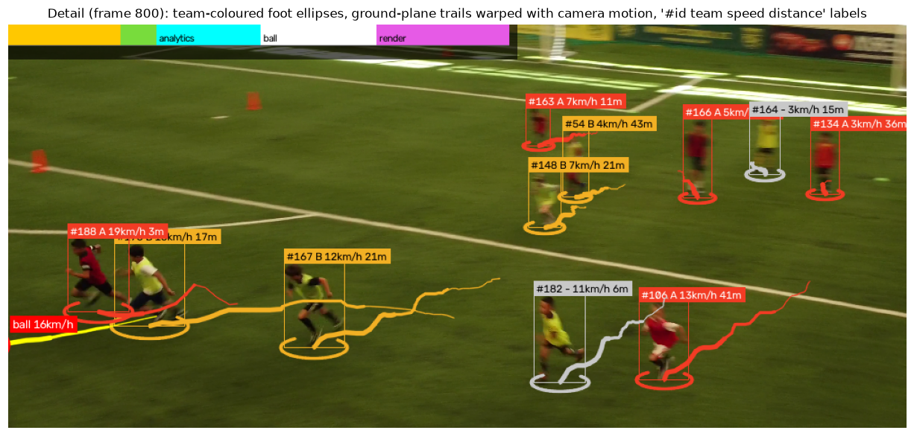
*Figure 16 — Per-player label: ID, team colour, speed.*

## 23. Performance and system monitoring

[`perf.hpp`](src/perf.hpp)/`.cpp` provides:

- **`RollingStat`** — O(1) rolling mean/percentiles over a window, for per-stage timings.
- **`PerfMonitor`** — aggregates stage timings (decode, detect, track, analytics, ball, render)
  and the end-to-end FPS, and identifies the current bottleneck shown in the HUD.
- **`SystemMonitor`** — loads `nvml.dll` **dynamically** (via `LoadLibrary`/`GetProcAddress`,
  so the binary runs even without NVML) to read GPU utilisation, memory, temperature and
  clocks; CPU/RAM come from the Win32 API (`psapi.h`, included **after** `windows.h` — issue
  [E2](#24-c-issue-log)).

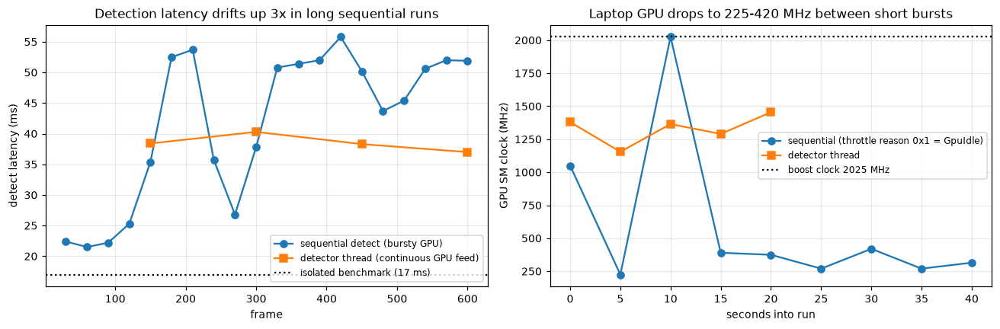
*Figure 17 — GPU clocks/thermals during a run; laptop thermal throttling drives FPS variance.*

**Difference from Python:** Python used `pynvml` and `psutil`. C++ links neither — it calls
NVML through `LoadLibrary` and the Windows API directly, so there is no extra dependency and no
hard requirement that NVML be present.

---

# Part V — Errors found and fixed

## 24. C++ issue log

These are the concrete problems solved while building the C++ port (the Python project's own
issue log E1–E31 is in its document). Each entry is: symptom → cause → fix.

| # | Symptom | Cause | Fix |
|---|---|---|---|
| **E1** | Overlay port/triplet ignored; vcpkg built the wrong ORT | Relative overlay paths in a separate `vcpkg-configuration.json` and in preset env vars are silently ignored | Put **absolute** overlay paths in `vcpkg.json` under `vcpkg-configuration` |
| **E2** | `psapi.h` compile errors | `psapi.h` included before `windows.h` | Include `windows.h` first, then `psapi.h` |
| **E3** | `LNK2019 __std_find_first_not_of_trivial_pos_1` in CLI11 | vcpkg auto-picked VS 2026 (MSVC 14.50) while the app used VS 2022 (14.44) → STL ABI mismatch | Custom triplet pinning `VCPKG_PLATFORM_TOOLSET v143` + `VCPKG_VISUAL_STUDIO_PATH` = VS 2022 |
| **E4** | `cl.exe` not found | Building outside a VS developer shell | Configure/build inside `vcvars64.bat` |
| **E5** | `constexpr cv::Vec3f` rejected | `cv::Vec3f` isn't a literal type | Use a non-`constexpr` `const` |
| **E6** | `Ort::Session::Run` won't compile on a const object | `Run` is non-const | Make `env_`/`fp16_` mutable; `createSession` const |
| **E7** | fp16 model produced garbage / wrong tensor size | fp16 models need fp16 I/O; `CreateTensor` takes a **byte** count | Convert I/O to `float16`; pass byte count with `ONNX_TENSOR_ELEMENT_DATA_TYPE_FLOAT16` |
| **E8** | Stale link after header change | Ninja missed a header dependency; old `detector.cpp.obj` | Delete stale `.obj` and rebuild |
| **E9** | Flaky `BoundedQueue` test | A race in the test timing | Rewrote the test to be deterministic |
| **E10** | Detector much slower than expected | Dynamic-shape ONNX disables cuDNN algo caching | Export **static-shape** models (86 → 62 ms) |
| **E11** | Conv still slow | Default cuDNN algo heuristics | `cudnn_conv_algo_search = EXHAUSTIVE` + max workspace (62 → 50 ms) |
| **E12** | Ball stage stalled the main detector | ROI detection shared the 1280 session/workspace | Dedicated **static-640** session (ball 65 → 10 ms) |
| **E13** | Output decode wasted time | Converting the whole fp16 output tensor | Decode fp16 **only for requested classes** (≈ −7 ms) |
| **E14** | TensorRT EP didn't load | Provider DLL absent; TRT 11.4 vs ORT version skew | Abandoned TRT; deleted the 2.3 GB wheels; stayed on the CUDA EP |
| **E15** | Peak speeds ~40 % low; distances inflated | Diagonal-gain Kalman approximation over-smoothed velocity | Full 4×4 matrix Kalman (matches Python; see §19) |
| **E16** | Duplicate tracks from tentative matches | New tracks were spawned from `freeDetHigh` (pre-tentative set) | Spawn from `freeDetFinal` (post-tentative leftovers) |
| **E17** | `Unable to find a valid Visual Studio instance at ".../2022/Professional" with toolset version v143` after a vcpkg tool update | The newer vcpkg compares `VCPKG_VISUAL_STUDIO_PATH` with the native Windows path, and the triplet used forward slashes | Write the path with escaped backslashes in the triplet (`"C:\\Program Files\\..."`). Changing the triplet changes the ABI hash, so vcpkg rebuilds the dependencies once |

---

# Part VI — Benchmarks

## 25. Performance journey

Detector latency (cool GPU) and end-to-end FPS as each optimisation landed:

| Stage | Change | Detect time | End-to-end FPS |
|---|---|---|---|
| 0 | Dynamic-shape ONNX, baseline | 86 ms | ~7.2 |
| 1 | Static-shape ONNX models (E10) | 62 ms | ~13.5 |
| 2 | cuDNN `EXHAUSTIVE` + max workspace (E11) | 50 ms | ~16.5 |
| 3 | Dedicated static-640 ball session (E12) | 50 ms (ball 65→10 ms) | ~20 |
| 4 | Single-pass fp16 preprocess, reused buffers | small gain | ~22 |
| 5 | Decode fp16 only for needed classes (E13) | ≈ −7 ms | **~25–31** |

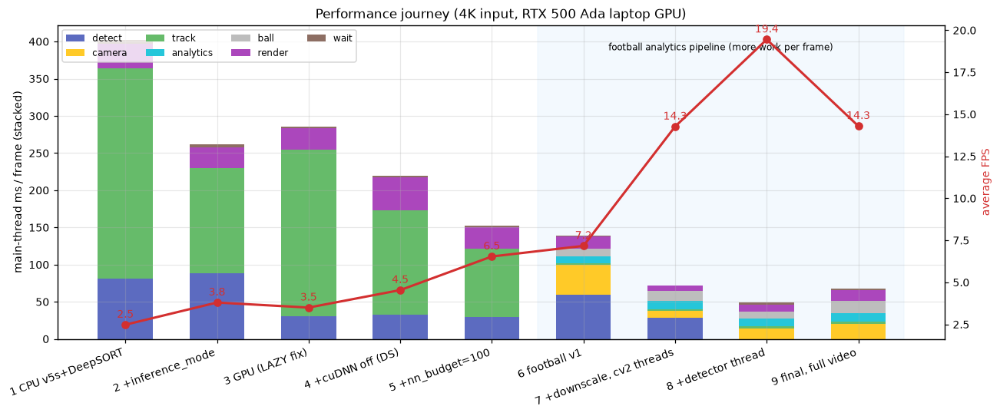
*Figure 18 — FPS climbing across the optimisation stages.*

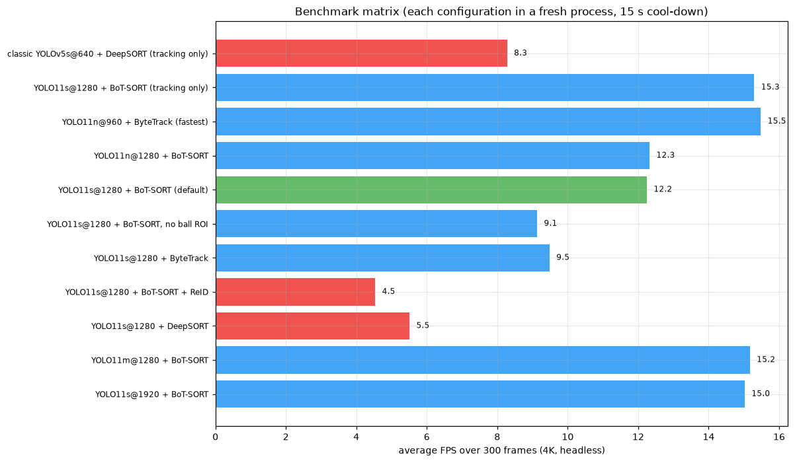
*Figure 19 — Benchmark FPS by configuration.*

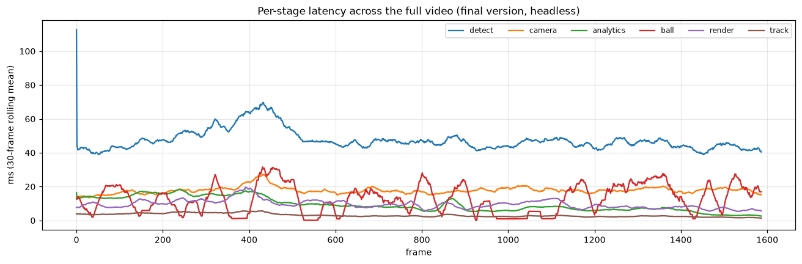
*Figure 20 — Per-stage timing breakdown; detection dominates, the main thread is lean.*

## 26. Methodology and results

Laptop GPUs throttle heavily, so the comparison uses **best-of-3 runs with 30 s cooldowns** on
the same segment (frames 400–650), both programs headless.

| Run | C++ FPS | Python FPS |
|---|---|---|
| 1 | 31.0 | 20.5 |
| 2 | 24.8 | 20.6 |
| 3 | 24.8 | 20.9 |

**Result: the C++ version is faster** — roughly 25–31 FPS vs. ~20.6 FPS. Two reasons: the C++
main thread (~31 ms) is leaner than Python's (~50 ms, which was main-thread-bound), and the ORT
detector with static shapes + exhaustive cuDNN search is faster than the PyTorch path. Both
builds are **Release** (`--config Release`); never benchmark Debug.

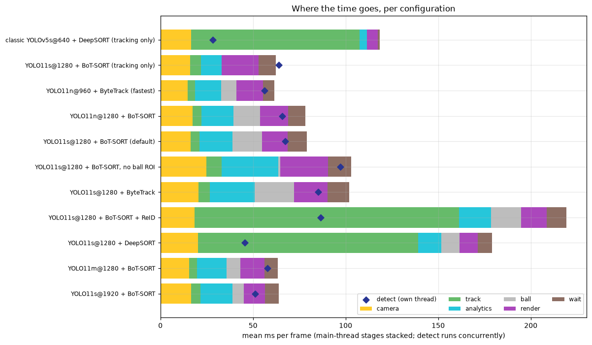
*Figure 21 — Stage timings across configurations.*

---

# Part VII — Equivalence with Python

## 27. Output equivalence study

To verify the port is behaviour-preserving, both programs processed the **same segment**
(`--start-frame 400 --max-frames 300`) and emitted `--stats-json`; the two files are compared
with [`tools/compare_stats.py`](tools/compare_stats.py).

| Metric | Python | C++ | Verdict |
|---|---|---|---|
| Camera tilt | 21.6° | 21.6° | **identical** |
| Camera height | 6.11 m | 6.14 m | identical (0.5 %) |
| Camera fit residual | 0.095 | 0.095 | **identical** |
| Ball detected ratio | 0.49 | 0.45 | close |
| Ball distance | 23.7 m | 23.2 m | **2 %** |
| Ball max speed | 38.9 km/h | 38.4 km/h | **1 %** |
| Team A track IDs | 10 | 10 | **identical** |
| Team A distance | 119 m | 99 m | close |
| Team A top speed | 16.0 km/h | 16.0 km/h | **identical** |
| Team A space control | 0.806 | 0.716 | close |
| Team B track IDs | 7 | 14 | **differs** |
| Team B distance | 66 m | 133 m | differs (follows ID count) |
| Team B top speed | 17.7 km/h | 14.2 km/h | close |
| Players tracked ≥ 1 s | 25 (mean 5.3 s) | 29 (mean 4.9 s) | close |

**Interpretation.** The *physics* — camera calibration, ball metrics, and (after the full-matrix
Kalman fix, §19) player speeds — is **equivalent**. Track **durations** also match (both have 12
tracks > 5 s, max ~10 s), so the tracker is not systematically fragmenting. The one real
difference is that the C++ **team classifier** assigns more borderline tracks to Team B (14 vs
7), which inflates Team B's aggregate distance. This is a **k-means boundary sensitivity**, not a
kinematics or tracking bug, and is listed as a known limitation ([§29](#29-known-limitations)).

The journey of the two headline kinematics metrics during debugging:

| | Python | C++ initial (diagonal KF) | C++ after confirmed-first match | C++ final (full KF) |
|---|---|---|---|---|
| Team A top speed | 16.0 | 9.6 | 9.6 | **16.0** |
| Team A IDs | 10 | 11 | 10 | 10 |
| Team A distance | 119 | 172 | 172 | **99** |

---

# Part VIII — Validation

## 28. Unit tests

The GoogleTest suite ([`tests/`](tests)) has **23 tests, all passing**, covering the parts most
likely to regress during a port:

| File | Covers |
|---|---|
| `test_geometry.cpp` | ground-model projection and the IRLS fit |
| `test_tracker.cpp` | IoU association, confirm/age lifecycle |
| `test_kinematics.cpp` | metric displacement, Kalman smoothing, sustained max |
| `test_team.cpp` | colour clustering and stable labels |
| `test_ball.cpp` | ball selection/gating and ROI logic |
| `test_space.cpp` | Voronoi assignment and percentages |
| `test_misc.cpp` | `BoundedQueue`, `RollingStat`, small utilities |
| `test_robustness.cpp` | panning is not a cut; a scene change is a cut and a non-pitch view; a green banner above a non-grass floor is not a pitch view; tracker reset issues fresh ids; ground reset requires recalibration |

Run them with CTest inside the VS environment:

```powershell
ctest --test-dir build -C Release
```

## 29. Known limitations

### 29.1 Using another football clip

The app is not tied to the reference video: pass any file with `--source`. Detection, tracking,
trails, heatmap, the counting line and the exports work on any reasonable football footage.
The **metric** analytics (speed, distance, space control, radar) rest on assumptions, though.
How well they hold depends on the kind of footage:

| Footage | Detection / tracking | Metric analytics | Notes |
|---|---|---|---|
| Drone or elevated tactical camera, one continuous shot (the reference) | ✅ | ✅ | the design target |
| Fixed high stand camera, wide | ✅ | ✅ | set `--hfov` for the lens |
| TV broadcast with cuts, replays, close-ups | ✅ (ids restart at each cut) | ⚠️ per shot only | cuts and non-pitch views are detected and reset (§15.1); totals are split per shot |
| Ground-level / phone at pitch side | ✅ | ❌ unreliable | strong perspective, players at very different depths; the elevated pinhole model barely fits (poor fit residual is reported) |
| Fisheye / action cam | ⚠️ | ❌ | lens distortion is not modelled |
| Low-resolution or heavily compressed (< 1280 px wide) | ⚠️ ball often missed | ⚠️ | warning printed; raise `--img-size` or use `yolo11m` |
| Two similar kits, or monochrome footage | ✅ | ⚠️ team split fails | use `--no-teams` |

What the app now checks automatically on every clip. The results appear in the log, the HUD
`src` line, the end report and the `source` block of `--stats-json`:

- **Frame rate.** Speeds are distance × fps, so a wrong frame rate scales every km/h value.
  Metadata outside 5–240 fps (0, NaN, 1000 on some remuxed files and webcams) is rejected, and
  30 fps is assumed with a warning. Use `--fps` to give the true value.
- **Shot cuts and non-pitch views:** see §15.1.
- **Low resolution:** a warning below 1280 px width.
- **Calibration quality:** a warning if the camera never calibrates (no fully visible standing
  players) or if the fit residual exceeds 25 %. Either one means the view doesn't match the
  elevated pinhole model.
- **Team separation:** a warning if the two kits never separate.

The limits that remain fundamental to a single uncalibrated camera:

- **Absolute scale comes from two assumptions:** the lens field of view (`--hfov`, default 70°)
  and the average person height (`--person-height`, default 1.4 m apparent box height). A 10 %
  error in either shifts every distance and speed by roughly 10 %. Relative comparisons between
  players stay valid. Expect about ±20 % absolute accuracy (the note in the stats JSON).
- **No pitch registration.** Positions are camera-centric metres, not pitch coordinates (no
  line or corner detection). Space control is computed over the *visible* turf, not the full
  pitch.
- **Flat-ground model.** Only feet on the ground plane are metric. A ball in the air is
  projected to where its image falls on the grass, so lobbed-ball speeds are approximate.
- **Identity through occlusion.** No appearance re-identification: a player leaving the frame
  and coming back gets a new id.
- **Hardware.** Real time needs an NVIDIA GPU with CUDA 12.8+ support. On CPU the same
  pipeline runs at a few FPS.

### 29.2 Port-specific limitations

- **Team B over-assignment.** The k-means jersey classifier is more sensitive at the colour
  boundary than Python's, so a few borderline tracks (near-outliers, partial occlusions) land in
  Team B. Fix ideas: carry Python's reference-colour seeding and the same outlier rejection.
- **Greedy tracker.** Greedy IoU and a diagonal-gain box filter fragment slightly more than
  Ultralytics' Hungarian BoT-SORT on crowded frames. A Hungarian assignment, and keeping lost
  tracks a few more frames, would close the gap.
- **Thermal variance.** FPS depends strongly on the laptop GPU's thermal state; use cooldowns
  when benchmarking.
- **Model coverage.** Static/640 exports currently exist for `yolo11s`; run `export_static.py`
  for `yolo11n`/`yolo11m` before using them with the ball ROI zoom.

---

# Part IX — Reference

## 30. Command-line options

(Abridged from `tracker.exe --help`.)

**Input / detection:** `--source`, `--model {yolo11n|yolo11s|yolo11m}`, `--models-dir`,
`--img-size`, `--conf`, `--iou`, `--classes`, `--device {auto|cpu|cuda[:N]}`, `--no-half`,
`--start-frame`, `--fps`, `--cuda-dir`.
**Tracking:** `--max-age`.
**Analytics:** `--no-ball`, `--no-ball-roi`, `--no-teams`, `--hfov`, `--person-height`,
`--max-depth`, `--voronoi`.
**Output / UI:** `--no-show`, `--display-width`, `--save`, `--tracks-csv`, `--perf-json`,
`--stats-json`, `--max-frames`, `--line`, `--trail-len`, `--queue-size`, `-v/--verbose`.

Removed vs Python: `--tracker`, `--reid`, `--n-init`, `--nn-budget`, `--embedder`, and the
`yolov5*`/`yolov8*` model names. Added vs Python: `--models-dir`, `--cuda-dir`, `--fps`, `-v/--verbose`.

To run on another clip:

```powershell
build\Release\tracker.exe --source C:\media\other_match.mp4 --hfov 60   # lens FOV of that camera
build\Release\tracker.exe --source clip.mkv --fps 25                    # broken frame-rate metadata
build\Release\tracker.exe --source broadcast.mp4 --no-teams             # similar kits
```

## 31. Output formats

- **`--save <path.mp4>`** — the annotated video (`mp4v`/MSMF writer).
- **`--tracks-csv <path>`** — per-frame rows: frame, id, class, team, box, foot point, speed.
- **`--stats-json <path>`** — camera model, per-team aggregates (IDs, distance, top speed, space
  control, possession), ball metrics, and per-player durations/distances. Format mirrors Python
  so the two are directly comparable (that is exactly what [§27](#27-output-equivalence-study)
  relies on). A C++-only `source` block adds the input checks: `fps`, `fps_source`
  (`stream` / `fallback` / `override`), `width`, `height`, `shot_cuts`, `non_pitch_frames`,
  `lower_turf_ratio_mean`, and a `warnings` list (also printed at the end of the run).
- **`--perf-json <path>`** — per-stage timing stats and FPS.

## 32. Keyboard shortcuts

| Key | Action |
|---|---|
| `q` / `Esc` | quit |
| `space` | pause/resume |
| `n` | step one frame while paused |
| `h` | toggle the HUD |
| `p` | toggle the football panel |
| `r` | toggle the radar |
| `v` | toggle the Voronoi space-control overlay |
| `t` | toggle trails |
| `m` | toggle the heatmap |
| `l` | toggle the counting line |
| `s` | save a PNG snapshot to `output/` |

## 33. Differences from Python — master list

A single consolidated list of every meaningful departure from the Python project:

1. **Language/runtime:** C++20 native exe; no Python, PyTorch, NumPy, SciPy at run time.
2. **Build:** CMake + vcpkg manifest, custom triplet, overlay port — vs. `pip`/`pyproject`.
3. **Inference:** ONNX Runtime (CUDA EP, fp16, static shapes) — vs. PyTorch Hub.
4. **CUDA:** DLLs fetched from NVIDIA wheels + `CUDA_MODULE_LOADING=LAZY` — vs. torch's bundled
   CUDA.
5. **Detector models:** YOLO11 only (n/s/m) — YOLOv5/YOLOv8 dropped.
6. **Tracker:** one self-written BoT-SORT (greedy IoU, BYTE) — DeepSORT/ByteTrack/ReID dropped.
7. **Numerics:** `cv::Matx` + hand-written IRLS and Kalman — vs. SciPy/NumPy.
8. **Video:** MSMF hardware decode, no FFmpeg.
9. **Monitoring:** NVML via `LoadLibrary` + Win32 API — vs. `pynvml`/`psutil`.
10. **CLI:** CLI11 with grouped, validated options; options removed/added as in §30.
11. **Kinematics:** full 4×4 matrix Kalman (equivalent to Python after the §19 fix).
12. **Threads:** true parallel `std::jthread` + `BoundedQueue` — vs. GIL-bound `threading`.
13. **Performance:** faster end-to-end (~25–31 vs ~20.6 FPS).
14. **Docs:** Doxygen comments throughout the source.
15. **Input robustness (C++ only):** shot-cut and non-pitch-view detection with resets, frame-rate
    validation plus `--fps`, and source warnings in the log, HUD, report and stats JSON (§15.1, §29.1).

---

# Appendices

## Appendix A — Camera model mathematics

The pinhole-on-a-plane model, the tilt/height parametrisation, and the mapping from image
points to the metric ground plane are unchanged from the Python project; the full derivation is
in [its Appendix A](../tracking/DOCUMENTATION.md). The C++ specifics:

- The robust fit is an **iteratively reweighted Gauss–Newton** loop. For residual `r` the weight
  is the `soft_l1` form `w = 1/√(1 + (r/0.08)²)`; the Jacobian is **numerical** (central-ish
  finite differences); the normal equations `(JᵀWJ) Δ = JᵀW r` are solved with `cv::Matx::solve`.
- State is smoothed with an EMA (α = 0.35), refit every 5 frames over a 30-sample window, with
  bounds tilt ∈ [1°, 85°] and height ∈ [1.5 m, 300 m].

## Appendix B — Kalman filter details

Two Kalman filters appear, both constant-velocity:

- **`KalmanBox`** (tracker) — state **xyah** (centre x, centre y, aspect, height) with
  diagonal gains. Used only for data association, where exact covariance coupling is not needed.
- **Kinematics filter** — state **[px, py, vx, vy]** in metres, with the **full** matrix update:

  ```
  predict:  x = F x                         F = [[1,0,dt,0],[0,1,0,dt],[0,0,1,0],[0,0,0,1]]
            P = F P Fᵀ + G Gᵀ q             G = [[dt²/2,0],[0,dt²/2],[dt,0],[0,dt]], q = accelσ²
  update:   y = z − H x                      H = [[1,0,0,0],[0,1,0,0]],  R = σ_m² I
            S = H P Hᵀ + R
            d² = yᵀ S⁻¹ y                     (Mahalanobis gate)
              d² > 36 → reset the filter (discontinuity)
              9 < d² ≤ 36 → inflate R by d²/9 (trust the measurement less)
            K = P Hᵀ S⁻¹
            x = x + K y
            P = (I − K H) P
  ```

  This is implemented with fixed-size `cv::Matx` types and is numerically identical to the Python
  reference — the fix that brought peak speeds into line ([§19](#19-kinematics-speed-and-distance-in-metres),
  issue [E15](#24-c-issue-log)).

## Appendix C — C++20 features used

The port leans on modern, *simple* C++20 — the brief asked explicitly for readable code, not
template gymnastics:

- **`std::jthread`** with cooperative `stop_token` for the decoder/detector threads (automatic
  join on destruction — no manual lifecycle).
- **Designated initialisers** for small config/struct literals.
- **`std::erase_if`** for pruning stale tracks/states.
- **`<ranges>`** algorithms (e.g. `std::ranges::min_element` for the sustained-max window).
- **`[[nodiscard]]`**, `constexpr`/`const` correctness, and structured bindings throughout.
- **`std::optional`** / `std::string_view` where they clarify intent.

Nothing exotic (no coroutines, no heavy metaprogramming): every module is meant to be read
top-to-bottom and understood, with Doxygen headers stating intent, parameters, and return values.

---

*End of document. For the algorithmic derivations and the original research narrative, see the
Python project's [`DOCUMENTATION.md`](../tracking/DOCUMENTATION.md).*
